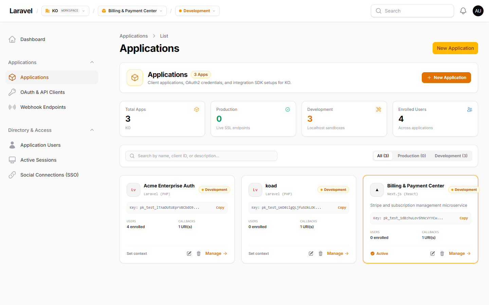
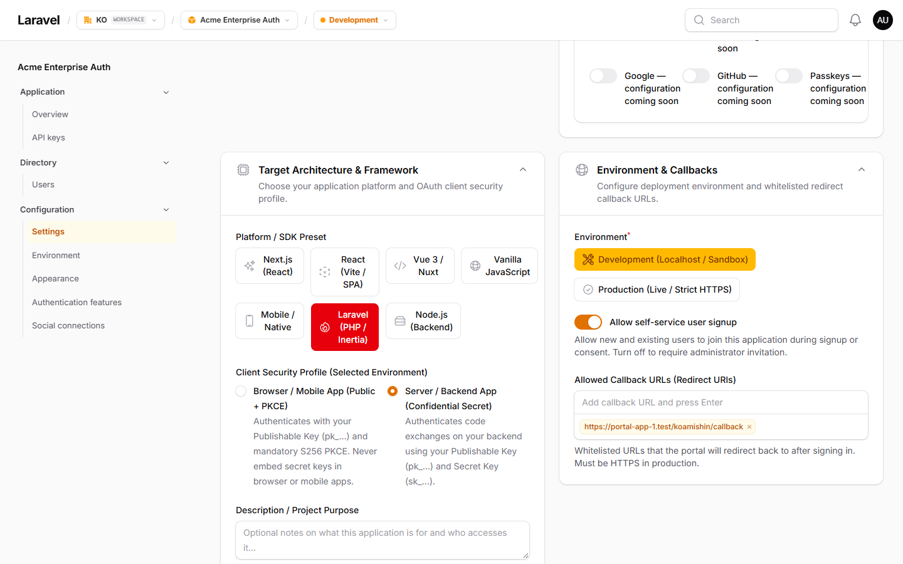
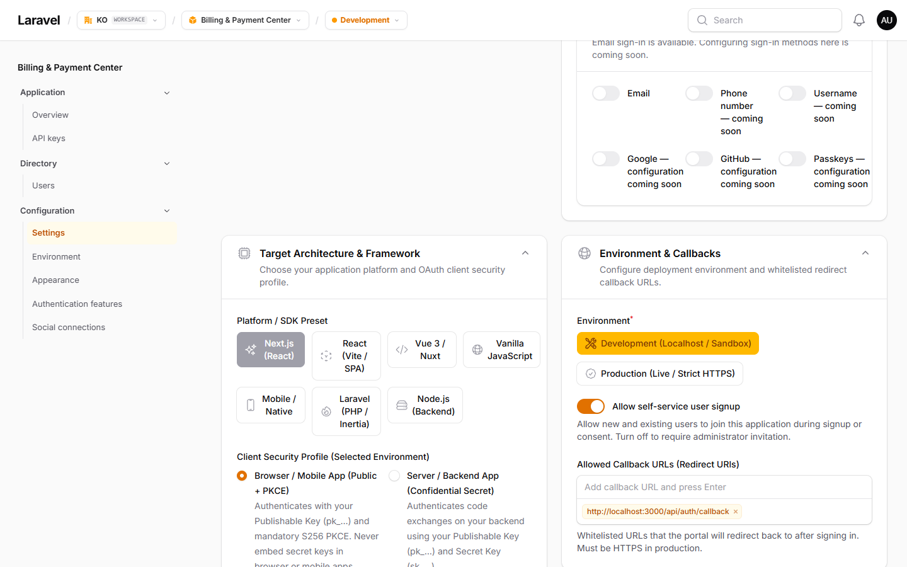
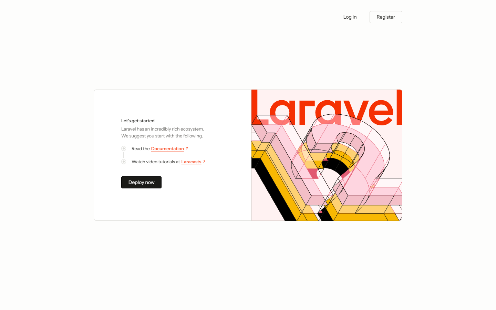
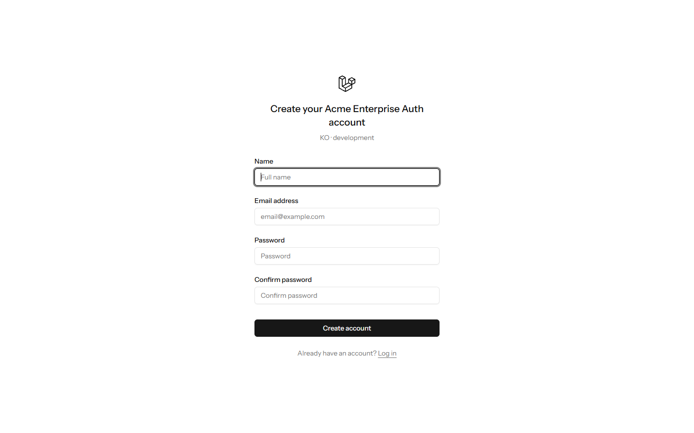
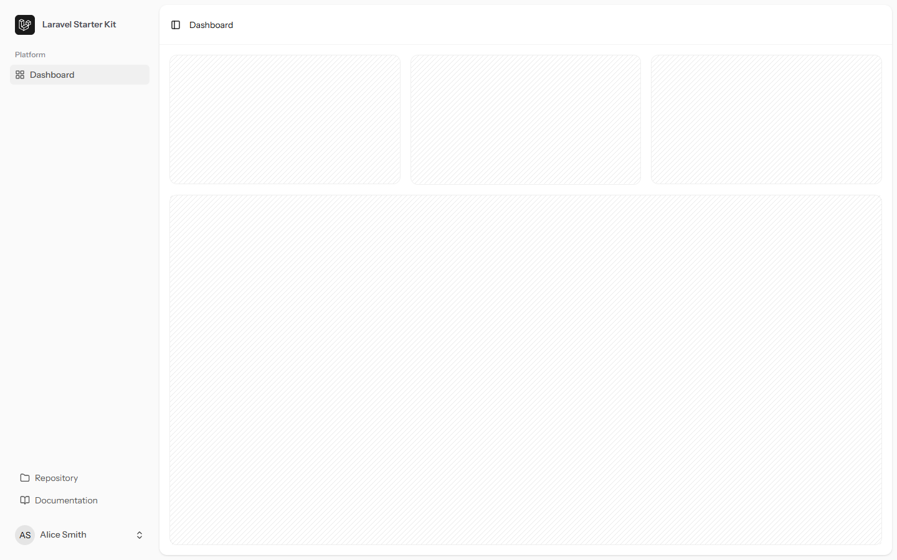
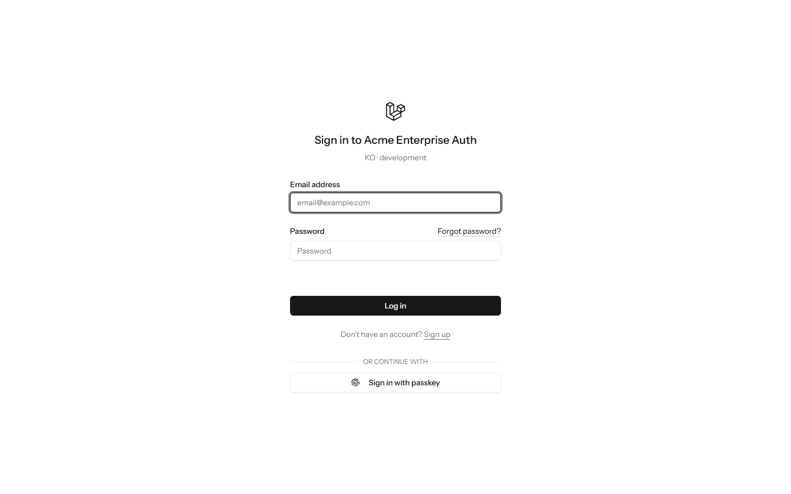
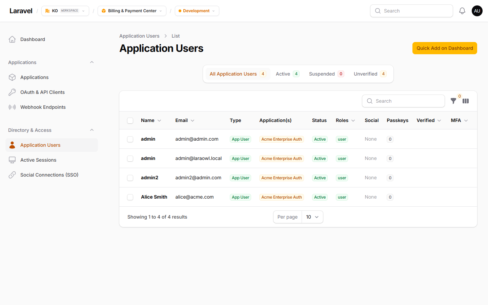

# Centralized login for two Laravel applications

This walkthrough connects two Laravel applications to one Koamishin Auth instance. App A starts a contextual registration flow, Koamishin Auth creates the account scoped to App A's environment, and OAuth returns the user to App A. App B can then authenticate its own users through its client. Each app keeps its own local session, application membership, isolated identity namespace, and metadata.

Self-service access is controlled by the selected environment's **Allow self-service signup** setting. When it is enabled, a new account can join that environment during signup. When the setting is missing or false, an administrator must enroll the user first.

## Before you start

Complete [installation](installation.mdx), including `/setup`. The local test environment uses these development-only origins:

| Service        | Origin                         | Callback                                         |
| -------------- | ------------------------------ | ------------------------------------------------ |
| Koamishin Auth | `http://auth.localhost:8120`   | —                                                |
| App A          | `http://app-a.localhost:8121`  | `http://app-a.localhost:8121/koamishin/callback` |
| App B          | `http://app-b.localhost:8122`  | `http://app-b.localhost:8122/koamishin/callback` |

Make sure all three hostnames resolve to the machine running the servers. Separate hostnames and host-only cookies keep session and CSRF cookies from different apps from interfering. Use HTTPS and your actual domains in production.

For your own local instance, configure its server origin and session settings before starting the server:

```dotenv
APP_URL=http://auth.localhost:8120
SESSION_COOKIE=koamishin_auth_session
SESSION_DOMAIN=null
MAIL_MAILER=log
```

`MAIL_MAILER=log` is for local testing. Verification messages and their links are written to `storage/logs/laravel.log`; configure a real mail transport for production. Use a separate browser profile for the administrator and the test user so their sessions do not replace each other.

## Step 1 — Register applications in the admin panel

In the Koamishin Auth administration panel, select your organization and create **App A** and **App B** separately. Each application represents an independent client with its own framework selection, OAuth client credentials, and environment configuration:

| Setting | App A (e.g. Acme Enterprise Auth) | App B (e.g. Billing & Payment Center) |
| --- | --- | --- |
| **Framework** | Laravel | Laravel / Next.js / Node.js |
| **Environment** | Development | Development |
| **Callback URL** | `https://portal-app-1.test/koamishin/callback` | `http://localhost:3000/api/auth/callback` |
| **Allow self-service signup** | Enabled | Enabled |
| **OAuth Consent Screen** | Off (first-party seamless) | Off (first-party seamless) |

Navigate to **Applications** (`/admin/<org>/tenant-applications`) to view the registered applications within your organization:



**Checkpoint:** Both applications appear in the organization overview under Development environments with distinct Client IDs.

---

## Step 2 — Configure callback URLs and credentials

### 2.1 Configure App A callback and signup policy

Open App A's settings (`/admin/<org>/tenant-applications/<id>/edit`) and scroll to **Environment & Callbacks**:

1. Set the active environment to **Development**.
2. Enable **Allow self-service user signup** to permit new user registration directly through App A.
3. Set the **Allowed Callback URLs (Redirect URIs)** to App A's exact OAuth callback endpoint (`https://portal-app-1.test/koamishin/callback`).



### 2.2 Configure App B callback and signup policy

Similarly, open App B's settings (`/admin/<org>/tenant-applications/<id>/edit`) and scroll to **Environment & Callbacks**:

1. Confirm the environment is set to **Development**.
2. Verify **Allow self-service user signup** matches your organization policy.
3. Configure App B's redirect URI (for example, `http://localhost:3000/api/auth/callback` or your consumer port callback).



### 2.3 Configure the Laravel clients with `.env` keys

Save each development Publishable Key (`pk_test_...`), Secret Key (`sk_test_...`), and numeric application ID. The application's Laravel environment snippet includes `KOAMISHIN_APPLICATION_ID`. Register the exact callback; a different host, port, or path is a different callback. Koamishin Auth validates the client and callback before displaying contextual login or registration.

Configure App A's `.env`:

```dotenv
APP_URL=https://portal-app-1.test
SESSION_COOKIE=app_a_session
SESSION_DOMAIN=null

KOAMISHIN_PORTAL_URL=https://koamishin-portal.test
KOAMISHIN_PUBLISHABLE_KEY=pk_test_app_a_key
KOAMISHIN_SECRET_KEY=sk_test_app_a_key
KOAMISHIN_REDIRECT_URI=https://portal-app-1.test/koamishin/callback
KOAMISHIN_APPLICATION_ID=3
KOAMISHIN_ENVIRONMENT=development
```

Configure App B's `.env` with its unique client ID, secret, and application ID:

```dotenv
APP_URL=http://app-b.localhost:8122
SESSION_COOKIE=app_b_session
SESSION_DOMAIN=null

KOAMISHIN_PORTAL_URL=https://koamishin-portal.test
KOAMISHIN_PUBLISHABLE_KEY=pk_test_app_b_key
KOAMISHIN_SECRET_KEY=sk_test_app_b_key
KOAMISHIN_REDIRECT_URI=http://app-b.localhost:8122/koamishin/callback
KOAMISHIN_APPLICATION_ID=1
KOAMISHIN_ENVIRONMENT=development
```

Keep secrets out of version control. Ensure each app has its own `APP_KEY` and a ready session store. Rebuild configuration caches after changing `.env`. The SDK checks the returned application ID and environment before accepting the identity.

---

## Step 3 — Registration flow through App A

### 3.1 Start registration from App A welcome page

Open App A in your browser (`https://portal-app-1.test/`). The application displays the public landing page with **Log in** and **Register** actions:



Click **Register**. The SDK generates a PKCE code challenge and state token, redirecting to Koamishin Auth with contextual query parameters (`client_id`, `redirect_uri`, `screen_hint=signup`).

### 3.2 Contextual hosted registration on Koamishin Auth

The user lands on the branded Koamishin Auth hosted registration screen displaying App A's name:



Enter user details (Name, Email address, and Password) and submit. Because **Allow self-service signup** is active, Koamishin Auth creates the account scoped to App A's environment, enrolls the user membership, and redirects back with the authorization code.

---

## Step 4 — Successful redirect to App A dashboard

Upon receiving the authorization code, App A exchanges it for tokens, synchronizes the user projection to its local database, and establishes the local session. The user is redirected to the authenticated dashboard:



**Checkpoint:** The dashboard displays the authenticated user profile (e.g. Alice Smith) with an active local session tied to App A.

---

## Step 5 — Log in to App B with seamless first-party sign-in

When the user navigates to App B (`http://app-b.localhost:8122/login` or its consumer login), App B redirects to Koamishin Auth:



Key characteristics of centralized authentication across applications:

- **Isolated Sessions:** App A and App B maintain separate session cookies (`app_a_session` vs `app_b_session`).
- **Seamless First-Party Experience:** Because **Require OAuth consent screen** is disabled by default, the user signs in directly without a third-party consent prompt.
- **Application Scoping:** If the user already has an account in the organization, signing into App B enrolls them into App B's membership while preserving their existing central identity.

---

## Step 6 — Verify user identities in the User Directory

Return to the Koamishin Auth administration panel and navigate to **Directory & Access → Application Users** (`/admin/<org>/users`):



**Checkpoint:** The directory displays the registered user (Alice Smith), showing their central user ID, active status, and explicit application memberships across both registered applications.

---

## Integration details: Routes and guards

In each app's `config/auth.php`, add this guard inside the existing `guards` array:

```php
'koamishin' => [
    'driver' => 'koamishin',
],
```

Add these routes to each app's `routes/web.php`, avoiding duplicate route names if the app already has authentication routes:

```php
use App\Exceptions\KoamishinIdentityConflict;
use App\Services\KoamishinUserProjector;
use Illuminate\Http\Request;
use Illuminate\Support\Facades\Route;
use InvalidArgumentException;
use Koamishin\Auth\Facades\Koamishin;

Route::get('/register', function () {
    return redirect()->away(Koamishin::getRegistrationUrl('/dashboard'));
})->name('register');

Route::get('/login', function () {
    return redirect()->away(Koamishin::getLoginUrl('/dashboard'));
})->name('login');

Route::get('/koamishin/callback', function (Request $request, KoamishinUserProjector $projector) {
    if ($request->query('error')) {
        abort(403, 'Sign-in was not completed.');
    }

    $input = $request->validate([
        'code' => ['required', 'string'],
        'state' => ['required', 'string'],
    ]);

    try {
        $identity = Koamishin::handleCallback($input['code'], $input['state']);
    } catch (InvalidArgumentException $exception) {
        abort(403, 'Invalid or expired sign-in request.');
    }

    try {
        $projector->sync($identity);
    } catch (InvalidArgumentException $exception) {
        Koamishin::logout();

        abort(403, 'The Portal identity does not match this application configuration.');
    } catch (KoamishinIdentityConflict $exception) {
        Koamishin::logout();

        abort(409, $exception->getMessage());
    }

    return redirect()->to(Koamishin::consumeReturnTo('/dashboard'));
});

Route::get('/dashboard', function (Request $request) {
    $identity = $request->user('koamishin');
    $localUser = App\Models\User::query()
        ->where('koamishin_user_id', $identity->id)
        ->firstOrFail();

    return response()->json([
        'id' => $identity->id,
        'local_user_id' => $localUser->id,
        'name' => $localUser->name,
        'email' => $localUser->email,
        'application_id' => $identity->applicationId,
        'environment' => $identity->environment,
        'public_metadata' => $localUser->koamishin_public_metadata,
    ]);
})->middleware('auth:koamishin');

Route::post('/logout', function () {
    Koamishin::logout();

    return redirect('/');
})->name('logout');
```

`getRegistrationUrl()` creates the same session-backed OAuth state and PKCE verifier as login, then adds `screen_hint=signup`. The Portal can therefore display the named application's registration page and resume the original authorization request. A plain redirect to the Portal's generic `/register` page has no originating application context.

The callback receives an authorization code, then the server exchanges it for tokens and fetches the permitted claims. User data and metadata are not placed in the callback URL. The route above projects the verified Portal subject before redirecting. Each app should have a unique `koamishin_user_id` column on its local `users` table. This sample expects the `email` scope and a non-empty email claim, and it mirrors central email verification to Laravel's `email_verified_at`. Store only the profile fields and public metadata that app needs; never store a Portal password or access token in that row. If a local account already has the same email, clear the SDK session and require an explicit trusted linking flow instead of matching by email. See the [SDK projection guide](../guides/laravel-sdk.mdx#maintain-a-local-eloquent-user-projection) for the migration and service.

The SDK guard still returns the central `KoamishinUser`. Resolve the local model explicitly when the app needs its own Eloquent relationships. For example, an app's `User::posts()` relation reads from that app's [REDACTED]; it does not fetch or join data from the Portal. Use the Portal management API for centrally owned data.

Submit logout through a CSRF-protected POST form; it clears the local app's SDK session without ending the Portal's browser session.

## 5. Add custom metadata from a trusted backend

New accounts start with empty application metadata. A trusted service can set values using a management credential bound to the appropriate application environment:

```php
use Koamishin\Auth\KoamishinManagementClient;

$management = app(KoamishinManagementClient::class);
$management->updateUserMetadata(
    $portalUserId,
    public: ['theme' => 'dark', 'plan' => 'standard'],
    private: ['internal_customer_id' => 'C-123'],
);
```

Provision the credential with `metadata:read` and `metadata:write`; see [application user metadata](../guides/user-metadata.mdx). Each supplied object replaces its entire bucket. The default SDK user scopes include `metadata:public`, so the next authenticated request can read `publicMetadata`. Private metadata remains available only through authorized management access. App A's metadata is not copied into App B's separate application environment.

## Closed signup and troubleshooting

For an environment with self-service signup disabled, an administrator must enroll the account in both the organization and that application environment. The Dashboard's **Import Users** workflow can attach an existing account; verify its email first and disable **Auto-verify** and **Update details** to preserve its existing credentials and roles. A management client with `memberships:write` can enroll an existing organization member by Portal user ID. See the [API reference](../reference/examples.mdx).

- **Registration opens a generic Portal page:** use `getRegistrationUrl()` and retain the Laravel session through the callback.
- **Signup or joining App B is denied:** check the selected environment's explicit signup policy, memberships, active client, and SDK application/environment configuration.
- **The callback fails:** check the exact registered host, port and path, the client secret, local hostname resolution, and session storage. Start a fresh flow from the app if its state expires.
- **Metadata is empty:** write values through the correct environment's management credential and request `metadata:public`. Global user metadata and private metadata are not userinfo claims.

For session refresh, authorization checks, webhooks, and deployment configuration, see [Laravel SDK integration](../guides/laravel-sdk.mdx). The Portal implements OAuth 2.0 with userinfo and does not issue OIDC ID tokens.
