# Installation & Getting Started

Koamishin Auth is a self-hosted, centralized identity provider. You deploy one authentication server that can power multiple applications with isolated development and production user environments.

This guide is a guided, screenshot-by-screenshot walkthrough. Follow it in order. Each step ends with a visual checkpoint so you know you are on track before moving on.

> **Expected final state:** One server running at your chosen origin, one organization, one application environment, and one connected application whose users can sign in through Koamishin Auth without an OAuth consent prompt.

---

## At a glance

| Area                                  | What you get                                                         |
| ------------------------------------- | -------------------------------------------------------------------- |
| **Centralized account access**        | One account server for all your apps                                 |
| **Isolated app environments**         | Separate `development` / `production` user namespaces                |
| **Zero-friction first-party sign-in** | No OAuth consent screen by default                                   |
| **Modern credentials**                | Publishable `pk_...` / Secret `sk_...` keys, S256 PKCE               |
| **SDKs**                              | `koamishin/auth-php` (Laravel) and `@koamishin/auth-js` (TypeScript) |
| **Security**                          | Passkeys, TOTP 2FA, social login hooks, signed webhooks              |

---

## Step 0 — Before you start

Make sure your environment meets these requirements:

| Component    | Minimum                                     | Notes                                                                                 |
| ------------ | ------------------------------------------- | ------------------------------------------------------------------------------------- |
| **PHP**      | 8.4 or 8.5                                  | Extensions: `pdo`, `mbstring`, `openssl`, `bcmath`, `curl`, `pcntl`, optional `redis` |
| **Composer** | 2.5+                                        | PHP dependency manager                                                                |
| **Node.js**  | 22.18+ or 24.11+                            | Vite asset bundling                                                                   |
| **Database** | PostgreSQL 17+, MySQL 8.4+, or SQLite 3.35+ | PostgreSQL is the default in Docker                                                   |
| **Redis**    | 7.0+                                        | Queues, sessions, and cache                                                           |

Pick one setup path:

- **Path A — Docker Compose (recommended):** Fastest for evaluation and staging.
- **Path B — Manual local setup:** Best for development or bare-metal servers.

---

## Path A — Docker Compose (recommended)

### Step 1 — Clone and configure

```bash
git clone https://github.com/koamishin/auth.git
cd auth
cp .env.example .env
```

Configure at minimum:

```dotenv
APP_NAME="Koamishin Auth"
APP_ENV=production
APP_DEBUG=false
APP_URL=http://localhost:8000

DB_CONNECTION=pgsql
DB_HOST=pgsql
DB_PORT=5432
DB_DATABASE=koamishin_auth
DB_USERNAME=portal
DB_PASSWORD=secret_password_here

REDIS_HOST=redis
REDIS_PORT=6379
QUEUE_CONNECTION=redis
SESSION_DRIVER=redis
CACHE_STORE=redis
```

### Step 2 — Launch and initialize

```bash
docker compose up -d

# Inside the running app container
docker compose exec portal php artisan key:generate --no-interaction
docker compose exec portal php artisan migrate --force --no-interaction
docker compose exec portal php artisan module:migrate --all --force --no-interaction
docker compose exec portal php artisan passport:keys --no-interaction
docker compose exec portal php artisan storage:link --no-interaction
```

**Checkpoint:** The app container is running and the [REDACTED] is migrated. Continue to [Step 1 — First-run setup](#step-1---first-run-setup).

---

## Path B — Manual local setup

### Step 1 — Install dependencies

```bash
git clone https://github.com/koamishin/auth.git
cd auth
composer install
cp .env.example .env
touch [REDACTED]/[REDACTED].sqlite
```

Configure `APP_NAME="Koamishin Auth"`, `APP_URL=http://localhost:8000`, SQLite/PostgreSQL settings, and `MAIL_MAILER=log` for local testing.

### Step 2 — Prepare the [REDACTED] and assets

```bash
php artisan key:generate --no-interaction
php artisan migrate --no-interaction
php artisan module:migrate --all --force --no-interaction
php artisan passport:keys --no-interaction
php artisan storage:link --no-interaction
npm ci
npm run build
composer run dev
```

**Checkpoint:** The server is reachable at `http://localhost:8000`. Continue to [Step 1 — First-run setup](#step-1---first-run-setup).

---

## Step 1 — First-run setup

### 1.1 Super Administrator setup and login gateway

1. Open your browser to the setup route or administrative gateway:

```text
http://localhost:8000/setup
```

2. Enter the **Instance Name** (defaults to _Koamishin Auth_) and the **Super Administrator** credentials: name, email, and password (minimum 8 characters).
3. Click **Initialize Portal & Launch**.

On first launch, Koamishin Auth creates a portal-identity super administrator and secures the setup route. Sign in through the Filament administrative gateway:

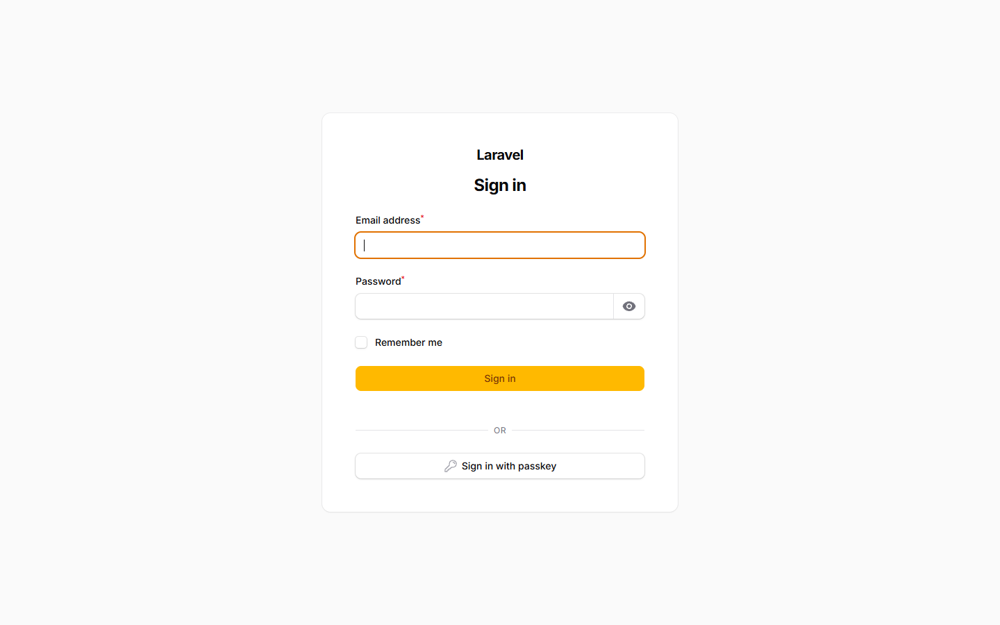

**Checkpoint:** Enter your administrator credentials and authenticate into the administration panel.

---

## Step 2 — Create an organization and register an application

### 2.1 Access the administration dashboard

Sign in with your administrator credentials to reach the main organization overview:

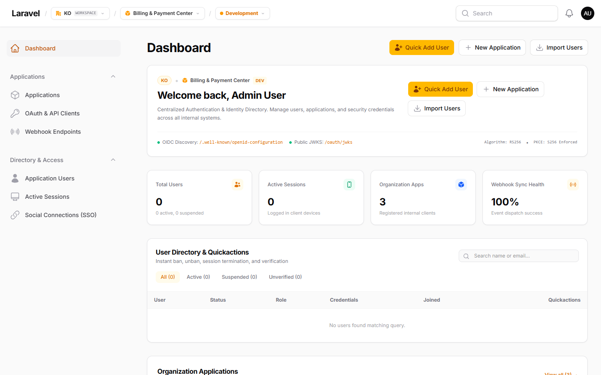

**Checkpoint:** The dashboard displays the organization workspace switcher, sidebar navigation, user directory overview, and registered applications.

### 2.2 Register a new organization

1. Navigate to `/admin/new` or select **New Organization** from the workspace dropdown.
2. Enter the **Organization Name** (e.g., _Acme Corp_) and **Organization Slug** (e.g., `acme-corp`).
3. Click **Register Organization**.

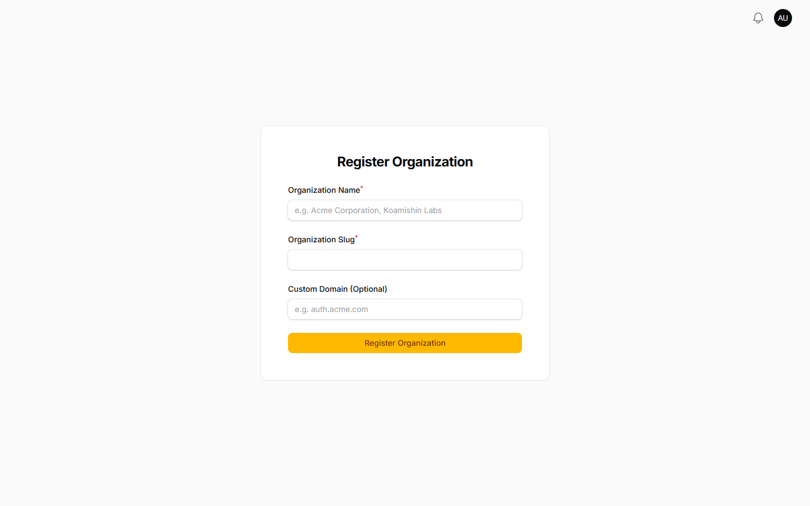

**Checkpoint:** The active workspace switches to your newly created organization.

### 2.3 Create a new application

1. In the sidebar navigation under **Applications**, click **Applications**.
2. Click **New Application** or navigate to `/admin/<org>/tenant-applications/create`.
3. Choose the project type (e.g., **Consumer**) and enter the **Application name** (e.g., _Acme Enterprise Auth_).

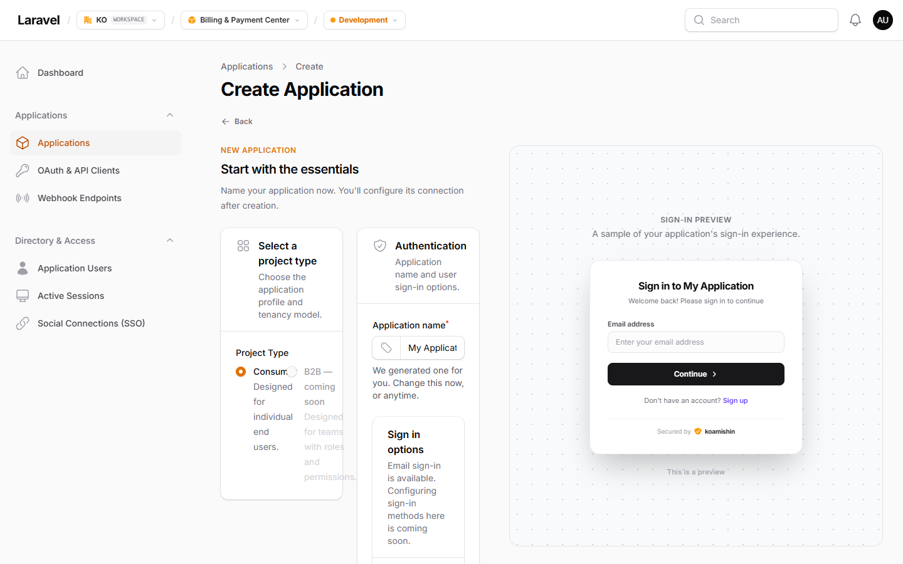

4. Click **Create application** to initialize the client credentials.

**Checkpoint:** The application record is created and opens into its configuration view.

### 2.4 Configure environment and allowed callback URLs

Scroll to the **Environment & Callbacks** section of the application configuration:

1. Select the active environment (**Development** or **Production**).
2. Ensure **Allow self-service user signup** is enabled if public registration is permitted.
3. Add your consumer application redirect URI under **Allowed Callback URLs (Redirect URIs)**, for example: `https://portal-app-1.test/koamishin/callback`.

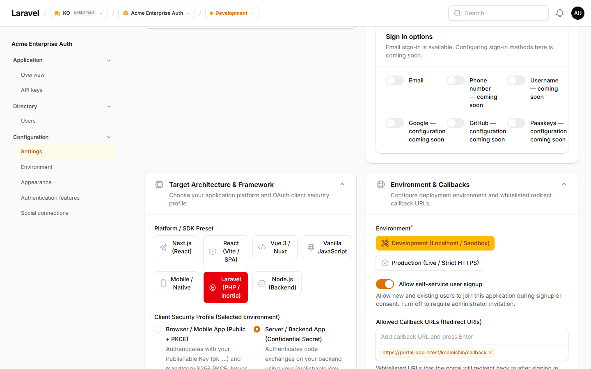

**Checkpoint:** The exact callback URL matches what your consumer client will pass during OAuth authorization requests.

### 2.5 Configure authentication features and consent policy

Scroll to the **Application authentication features** section:

1. Set the **Email verification** policy for your application.
2. Toggle **Allow passkey sign-in** to enable FIDO2 WebAuthn biometric login.
3. Configure the **Require OAuth consent screen** switch. For seamless first-party internal applications, leave this **OFF** so users sign in without an extra consent authorization prompt.

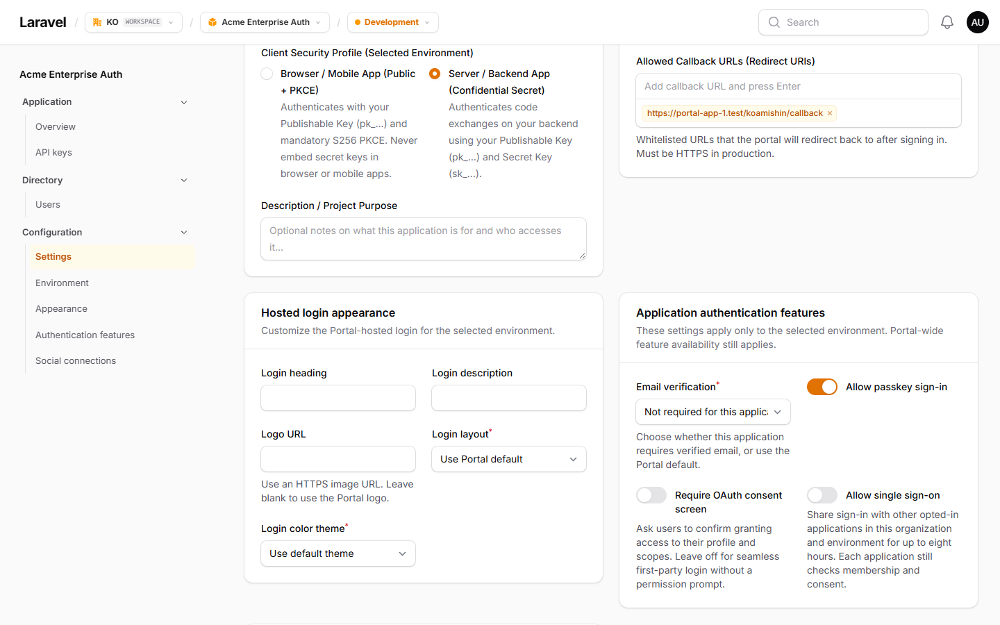

4. Click **Save changes** at the bottom of the form.

**Checkpoint:** Authentication toggles and consent behavior are saved for the target environment.

### 2.6 Copy application credentials and environment snippets

Open the application overview (`/admin/<org>/tenant-applications/<id>`) to inspect your API credentials:

1. Copy the **Publishable Key** (`pk_test_...` or `pk_live_...`).
2. Copy the **Secret Key** (`sk_test_...` or `sk_live_...`) if connecting a confidential server-side client (Laravel, Node.js).
3. Copy the numeric **Application ID**.

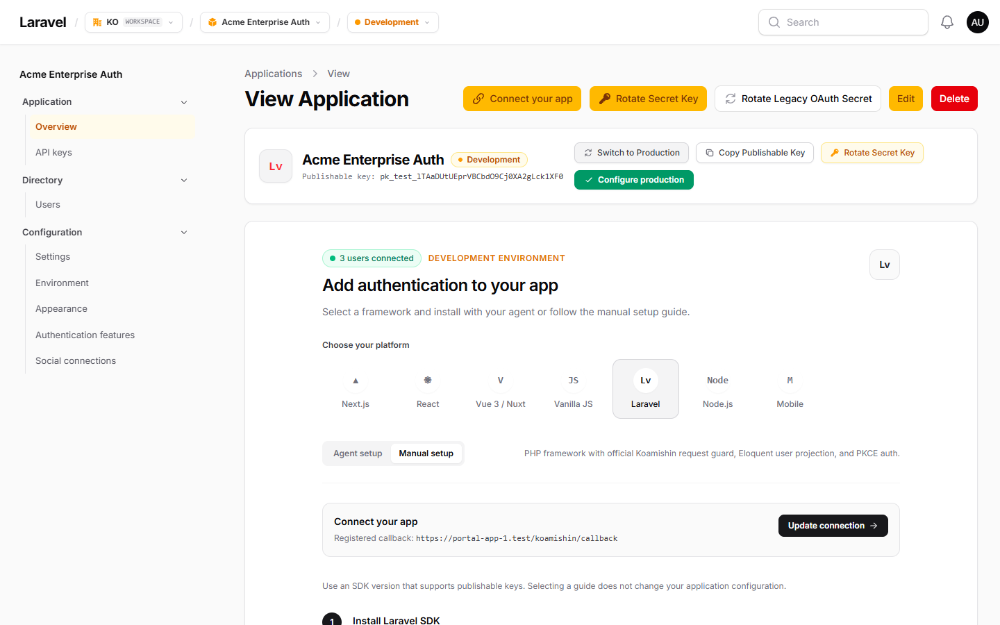

Insert these values into your consumer application's `.env`:

```dotenv
KOAMISHIN_PORTAL_URL=http://localhost:8000
KOAMISHIN_PUBLISHABLE_KEY=pk_test_your_publishable_key
KOAMISHIN_SECRET_KEY=sk_test_your_secret_key
KOAMISHIN_REDIRECT_URI=https://app.example.test/koamishin/callback
KOAMISHIN_APPLICATION_ID=1
KOAMISHIN_ENVIRONMENT=development
```

### 2.7 Application overview and slide-over setup guide

Once users connect, the inline setup guide automatically collapses to keep the overview clean, focusing on active users, credentials, and quick actions:

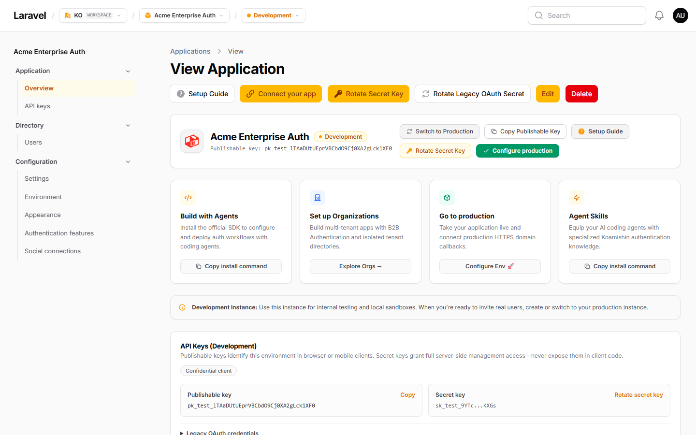

Need to reference setup instructions or copy integration code for another platform? Click the **Setup Guide** button (or question-mark icon) in the header to open the interactive setup guide in a slide-over sheet without leaving your overview:

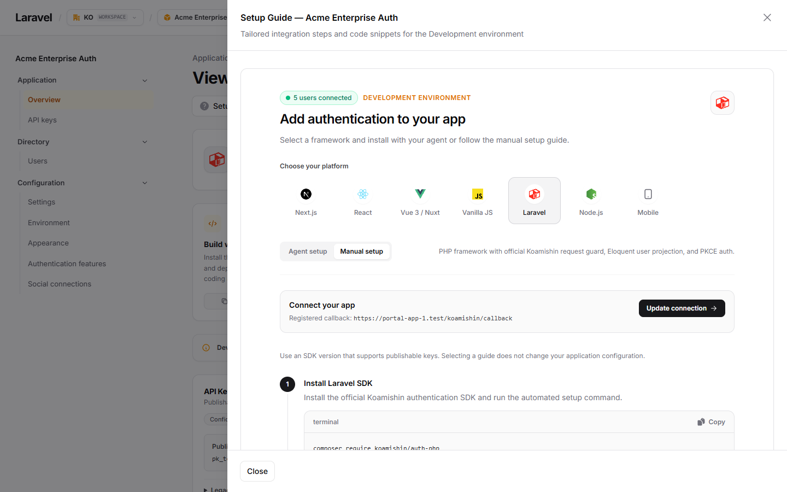

**Checkpoint:** Your consumer application has all environment variables required by the SDK.

**Checkpoint:** Your consumer application has all environment variables required by the SDK.

---

## Step 3 — Connect your consumer application and authenticate

### 3.1 Consumer application welcome screen

Open your consumer application home page. The application displays **Log in** and **Register** buttons wired to the Koamishin Auth SDK routes:

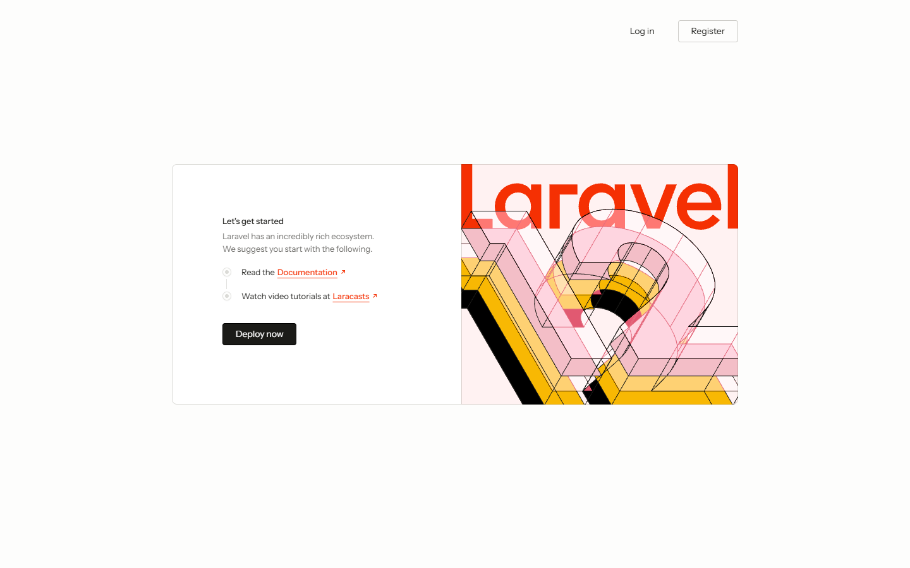

### 3.2 Hosted application sign-in

Click **Log in** on the consumer app. The user is redirected to the branded Koamishin Auth hosted login screen:

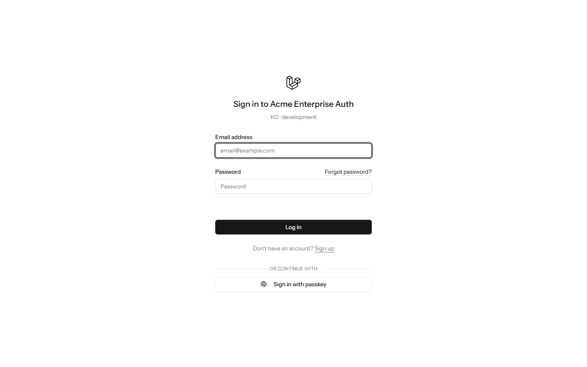

Users enter their email and password, or use passwordless authentication via passkey. Because first-party OAuth consent is disabled by default, the user is authenticated and immediately redirected back to the consumer app callback without unnecessary prompts.

### 3.3 Hosted application registration

If self-service signup is enabled, new users can click **Register** (or **Sign up**) on the consumer app to reach the hosted registration form:

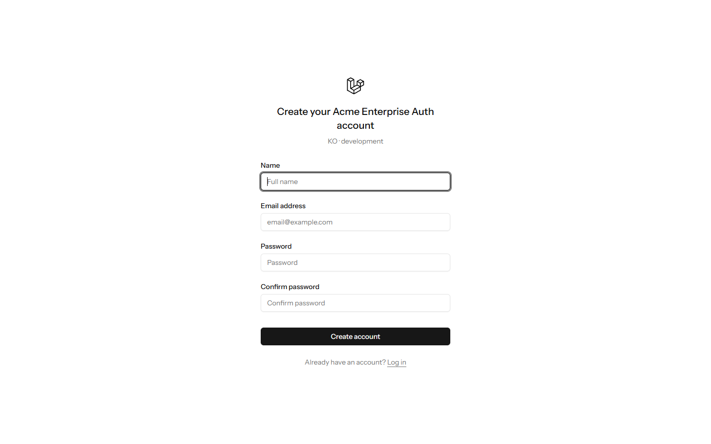

When submitted, Koamishin Auth creates the user account scoped to the application environment, enrolls the membership, and redirects back with the authorization code to complete login.

**Expected outcome:**

- Consumer app displays the authenticated user.
- User belongs to your selected application environment, not the portal admin dashboard.
- Same email cannot collide with another app because each environment has its own identity namespace.

---

## Step 4 — Verify your identity provider

Run these checks from the host machine or server:

```bash
# Healthcheck
curl http://localhost:8000/up

# OIDC discovery
curl http://localhost:8000/.well-known/openid-configuration

# Public RS256 JWKS
curl http://localhost:8000/oauth/jwks
```

If these return `200`, the installation is healthy.

---

## Common gotchas

1. **Application callback mismatch:** The registered callback and SDK redirect URI must match exactly, including scheme, host, port, and path.
2. **Lost keys:** Regenerate them from the application environment settings if a secret key is lost.
3. **Signup policy misconfiguration:** If new users cannot register, enable **Allow self-service signup** in the environment settings.
4. **Noisy OAuth consent:** Keep **Require OAuth consent screen** off unless you explicitly want a third-party-style permission prompt.

Next, continue with [Laravel SDK integration](../guides/laravel-sdk.mdx) or the [two-application walkthrough](centralized-auth.mdx).

---

## Next Steps

- Follow the [Centralized Auth Walkthrough](centralized-auth.mdx) to connect two separate Laravel apps to this Portal.
- Explore the [Laravel PHP SDK Guide](../guides/laravel-sdk.mdx).
- Learn how to manage [Application User Metadata](../guides/user-metadata.mdx).
- Review [Production Deployment & Operations](../guides/ci-cd.mdx) before hosting on public infrastructure.
